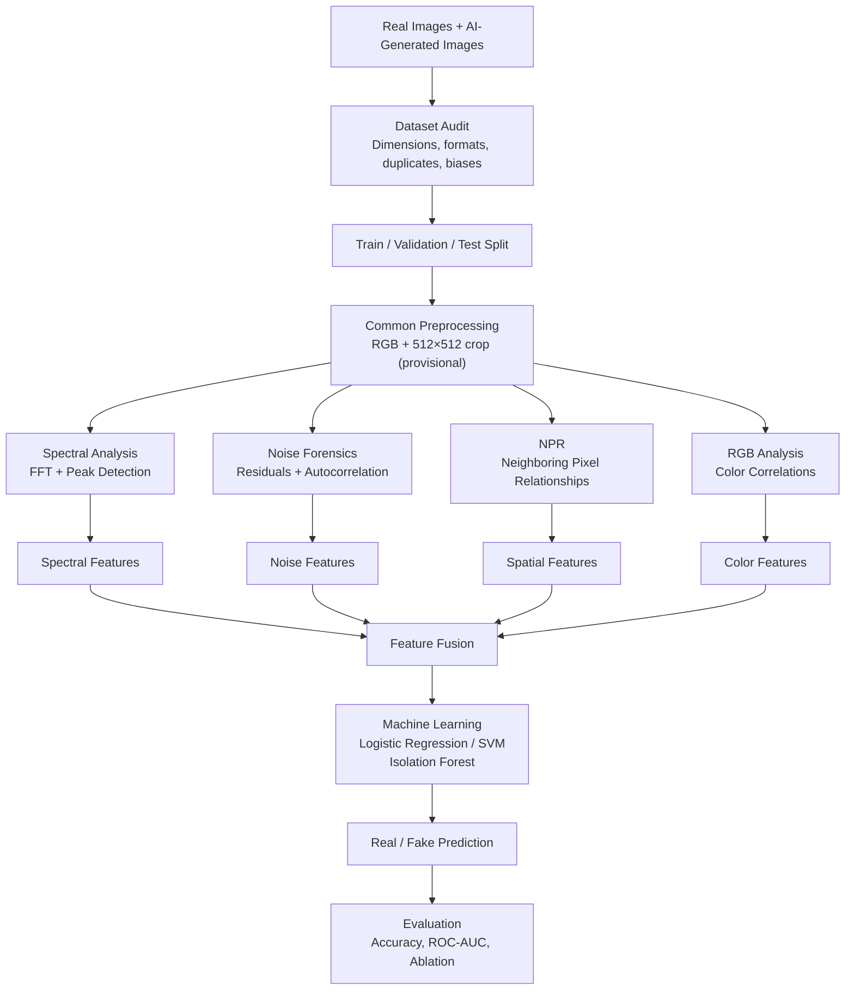

Goal: Distinguish fake from real images

How to: Anything is allowed, except simply training a model to distinguish real from fake images (you can use machine learning if you want, but only in a thoughtful way or combined with smart feature engineering).

An idea to start: look at the Fourier transform of fake images (possibly use high-pass filtering before doing the transform). Average the transform of multiple fake images to see what you are looking for. Use morphological dilation to see peaks more easily.

If you need more images (e.g. for training), you can use the following datasets (or any other if you prefer)

* Fake images: Synthbuster dataset (the provided images are from the midjourney subset): https://zenodo.org/records/10066460
* Real images: Raise dataset (the provided images are part of it): https://loki.disi.unitn.it/RAISE/download.html


# Deepfake Detection — Image Forensics & Machine Learning


**Goal:** Distinguish real photographs from AI-generated images by investigating the digital traces left by their creation processes.

**Constraint:** No direct end-to-end training of a Real/Fake image classifier. Our approach combines image processing, handcrafted forensic features, and lightweight machine learning.

**Environment:** Python · NumPy · SciPy · scikit-image · scikit-learn · CPU

---

## 1. Our Approach

Rather than asking a neural network to learn what fake images look like, we investigate **how real and synthetic images are produced**.

| Real photographs 📷              | AI-generated images 🤖          |
| -------------------------------- | ------------------------------- |
| Camera sensor noise              | Generative model artifacts      |
| Demosaicing and image processing | Upsampling-related correlations |
| Camera-specific fingerprints     | Unusual frequency patterns      |
| Physical image acquisition       | Algorithmic image synthesis     |

**Research question:**

*Can spectral, noise-based, spatial, and color features provide complementary information for detecting AI-generated images?*

---

## 2. Candidate Detection Methods

We plan to investigate four complementary approaches.

### A. Spectral Analysis — FFT

**Hypothesis:** Some generative models leave periodic artifacts that can be detected in the frequency domain.

**Methods:**

- Compute the 2D Fourier Transform (FFT).
- Apply high-pass filtering to highlight subtle artifacts.
- Compare average Real/Fake frequency spectra.
- Detect spectral peaks using morphological operations.
- Extract frequency-band energy and peak statistics.

**Output:** Spectral feature vector.

**Key concepts:** FFT · High-pass filtering · Power spectrum · Morphological dilation

### B. Noise Forensics

**Hypothesis:** Real photographs and AI-generated images exhibit different high-frequency residual statistics.

**Methods:**

- Extract noise residuals through denoising.
- Analyze residual variance and distribution.
- Compute spatial autocorrelation.
- Investigate noise regularity and local statistics.

**Output:** Noise-based feature vector.

**Key concepts:** Denoising · Image residuals · Noise statistics · Autocorrelation

### C. Neighboring Pixel Relationships (NPR)

**Hypothesis:** Upsampling operations in some generative networks introduce distinctive dependencies between neighboring pixels.

**Methods:**

- Compute relative pixel differences in 2×2 blocks.
- Analyze horizontal, vertical, and diagonal relationships.
- Compare local difference distributions.
- Investigate periodic patterns and block alignment.

**Output:** Spatial correlation feature vector.

**Key concepts:** Pixel differences · Spatial correlations · Upsampling artifacts

**Reference:** [Neighboring Pixel Relationships — CVPR 2024](https://openaccess.thecvf.com/content/CVPR2024/html/Tan_Rethinking_the_Up-Sampling_Operations_in_CNN-based_Generative_Network_for_Generalizable_CVPR_2024_paper.html)

*Our implementation will be a handcrafted statistical adaptation, not a full reproduction of the paper's neural detector.*

### D. RGB & Color Analysis

**Hypothesis:** Physical image acquisition and generative models may produce different statistical relationships between color channels.

**Methods:**

- Measure correlations between R, G, and B channels.
- Analyze high-frequency residuals separately for each channel.
- Investigate cross-channel residual correlations.
- Explore possible demosaicing-related signatures.

**Output:** Color feature vector.

**Key concepts:** RGB correlations · Color residuals · Demosaicing

*Optional extension: camera fingerprints. Full PRNU estimation would require appropriate reference photographs and is not part of the core implementation.*

---

## 3. Complete Processing Pipeline



**Core principle:** Every image is transformed into a fixed-length numerical feature vector, independently of the detection method.

---

## 4. Dataset & Preprocessing

### Datasets

| Dataset                                 | Purpose                             | Source                                                                      |
| --------------------------------------- | ----------------------------------- | --------------------------------------------------------------------------- |
| Professor's dataset (50 Real + 50 Fake) | Initial exploration and prototyping | [ATHENS project](https://bammey.com/teaching/athens2026/projects/deepfake/) |
| Synthbuster (1,000+ selected images)    | Synthetic training/evaluation data  | [Zenodo](https://zenodo.org/records/10066460)                               |
| RAISE-1k                                | Real training/evaluation data       | [RAISE](https://loki.disi.unitn.it/RAISE/download.html)                     |

### Dataset Preparation

**Step 1 — Audit**

- Inspect image resolutions and formats.
- Check RGB channels, bit depth and corrupted files.
- Identify duplicates and potential dataset biases.
- Compare acquisition and storage characteristics between Real/Fake.

**Step 2 — Data Splitting**

- Create reproducible, stratified Train/Validation/Test splits.
- Keep the final test set unseen during development.
- Avoid overlap between the professor's sample and the extended dataset.

**Step 3 — Preprocessing**

- Preserve original RGB information.
- Tentatively extract one central 512×512 crop per image.
- Avoid resizing, denoising or compression during common preprocessing.
- Convert pixel arrays into a consistent numerical representation.

*The cropping strategy will be finalized after inspecting actual image dimensions. Crop size alone does not eliminate source-resolution biases.*

---

## 5. Feature Engineering & Machine Learning

Each method independently computes numerical characteristics:

| Feature group | Examples                                                    |
| ------------- | ----------------------------------------------------------- |
| Spectral      | Frequency-band energy, spectral peak count, peak prominence |
| Noise         | Residual variance, autocorrelation, statistical moments     |
| NPR           | Local pixel differences, spatial correlations               |
| RGB           | Interchannel correlations, color-residual statistics        |

### Feature Fusion

For image (i), we concatenate the feature vectors:

[
X_i = [X_i^{FFT}, X_i^{Noise}, X_i^{NPR}, X_i^{RGB}]
]

The resulting matrix has one row per image and one column per feature.

### Models to Compare

| Model                       | Purpose                                          |
| --------------------------- | ------------------------------------------------ |
| Simple statistical baseline | Verify the pipeline and provide a reference      |
| Logistic Regression         | Interpretable supervised feature combination     |
| SVM                         | Classification based on engineered features      |
| Isolation Forest            | Anomaly detection trained on real-image features |

**Evaluation:**

- Accuracy and F1-score
- Confusion matrix
- ROC-AUC
- Ablation study: each feature family separately vs. combined
- Optional JPEG compression robustness test

**Important:** All preprocessing statistics, feature selection and model hyperparameters must be fitted using training/development data only.

---

## 6. Suggested Team Organization

| Member       | Main responsibility        | Deliverables                                    |
| ------------ | -------------------------- | ----------------------------------------------- |
| **Member 1** | Spectral analysis          | `spectral.py`, spectral plots, FFT features     |
| **Member 2** | Noise Forensics + RGB      | `noise_rgb.py`, noise/color statistics          |
| **Member 3** | NPR + optional demosaicing | `npr.py`, spatial features                      |
| **Member 4** | ML pipeline + evaluation   | `ml_pipeline.py`, baseline, metrics, comparison |

### Common Starting Task

Before parallel development, the whole team will:

1. Audit the initial dataset.
2. Agree on image preprocessing.
3. Define Train/Validation/Test splits.
4. Establish a shared feature extraction interface.

Each feature extractor receives an RGB image and returns a dictionary of numerical features.

All exported feature tables must use consistent image identifiers.

### Parallel Development

**Members 1–3:** Implement and test independent forensic feature extractors.

**Member 4:** Build the ML infrastructure immediately using a simple statistical baseline (intensity mean, standard deviation, entropy, gradient energy). Integrate the other feature sets as they become available.

---

## 7. Proposed Two-Day Schedule

| Phase                   | Tasks                                                           | Expected result               |
| ----------------------- | --------------------------------------------------------------- | ----------------------------- |
| **Day 1 — Setup**       | Dataset audit, preprocessing, shared conventions                | Reproducible dataset pipeline |
| **Day 1 — Development** | Parallel implementation of FFT, Noise/RGB, NPR, and ML baseline | Independent working modules   |
| **Day 1 — Integration** | Export and merge initial feature vectors                        | First end-to-end detector     |
| **Day 2 — Experiments** | Train models, compare feature families                          | Performance comparison        |
| **Day 2 — Validation**  | Ablation, final test, optional robustness checks                | Scientific results            |
| **Day 2 — Delivery**    | Figures, clean code, presentation                               | Reproducible final project    |

---

## 8. Expected Deliverables

- [ ] Dataset audit and preprocessing pipeline
- [ ] Visual comparison of Real/Fake spectral signatures
- [ ] Noise and residual statistical analysis
- [ ] NPR feature extraction
- [ ] RGB correlation analysis
- [ ] Feature fusion and trained ML models
- [ ] Evaluation metrics and ablation study
- [ ] Working Real/Fake prediction script
- [ ] Final presentation with observations and limitations

---

## 9. Project Structure

```text
deepfake-project/
├── data/
│   ├── sample/
│   └── extended/
├── src/
│   ├── preprocessing.py
│   ├── spectral.py
│   ├── noise_rgb.py
│   ├── npr.py
│   └── ml_pipeline.py
├── notebooks/
├── results/
│   ├── figures/
│   └── metrics/
├── README.md
├── requirements.txt
└── .gitignore
```

**Note:** Raw datasets and large image archives should remain outside Git version control.

---

## 10. Main Scientific Questions

1. Which handcrafted features best distinguish real and synthetic images?
2. Are spectral, noise, NPR and color features complementary?
3. Does combining features improve classification compared with individual methods?
4. Are the detected signatures genuinely related to image formation, or are they caused by dataset biases?
5. How robust is the detector to common image transformations?

**Final objective:** Build an interpretable, CPU-friendly detection system while investigating the digital traces of image generation, rather than relying on end-to-end deepfake classification.
